## Hi, I'm Davron 👋

I've worked in tech support for computer clubs for 5 years. The software we used kept crashing, locking
people out and billing by IP address, so I'm learning to code by **building the replacement myself**.
It already runs on real club hardware.

## Experience

- 🖥️ **5 years of tech support for computer clubs**: keeping gaming PCs running, fixing broken operating systems and software-level faults
- 🐧 **2-3 years of daily Linux** (Arch), plus Windows

## Languages

| Language | Level |
| --- | --- |
| 🇺🇿 Uzbek | Native |
| 🇬🇧 English | C1 |
| 🇷🇺 Russian | B2 |

## Skills

| Level | What |
| --- | --- |
| Comfortable | Go, HTML, CSS, Linux, Windows troubleshooting |
| Learning now | Rust 🦀 |
| The basics | Python, C# |

I can read code in most languages and understand what it does, even ones I haven't learned yet.

-000000?style=for-the-badge&logo=rust&logoColor=white)

## What I've built

| Project | What it does | Stack |
| --- | --- | --- |
| [**ClubControl**](https://github.com/Mypatoff/ClubControl) | PC lock + billing system for computer clubs: an admin panel on one laptop, a kiosk client on every gaming PC | C#, WPF, .NET 8 |
| [**TimeTable**](https://github.com/Mypatoff/TimeTable) | School timetable (*dars jadvali*) manager that generates a weekly schedule for every class at once | C#, WPF |
| [**screentime**](https://github.com/Mypatoff/screentime) | Linux screen-time tracker with a local web dashboard | Python, Flask, SQLite |
| [**wasteless**](https://github.com/Mypatoff/wasteless) | Local savings and wasted-money tracker, no login, single user | Go |
| [**online-shop-management**](https://github.com/Mypatoff/online-shop-management) | Free shop management app that runs on localhost from one `.exe` or `.sh` | Go |

## Achievements

- ✅ ClubControl is running on real club hardware
- 📦 8 public repos in about 6 months, with automatic builds, one-file installers and self-updating apps
- 🔒 Found and fixed a real billing-bypass hole in my own software

## How I build

I build with AI (Claude Code) as my coding partner, and I'm upfront about it. I decide what the software
has to do, test it on real machines, and learn from the code as it gets written.
I care most about software that **keeps working when something goes wrong**: no lockouts, no crash loops,
and installs a non-technical person can do by double-clicking one file.
